# 📍 GpsTrack — Real-Time GPS Tracking via Telegram

<p align="center">
  
</p>

<p align="center">
  <b>Track your devices in real time, directly on your phone.</b><br/>
  No monthly subscriptions. No complicated setup. Just Telegram.
</p>

<p align="center">
  <a href="https://t.me/White_List_111_bot">
    
  </a>
  &nbsp;
  
  &nbsp;
  
</p>

---

## 🚀 What is GpsTrack?

GpsTrack is an Android app that lets you track GPS devices in real time on an interactive map. It uses **Telegram** as the communication layer — meaning your tracker sends location updates through a Telegram bot, and the app picks them up instantly. Your phone can also become the tracker: GpsTrack can broadcast its own GPS location out over Telegram the same way.

No custom servers. No recurring fees. No ADS. The **Free** plan tracks one device; **Pro** is a one-time payment (no subscription) that unlocks unlimited devices. See [Free vs Pro](#-free-vs-pro).

---

## ✨ Features

| Feature | Description |
|---|---|
| 📡 Live Tracking | See your device move on the map in real time |
| 🛰️ Broadcast Mode | Turn your phone into a tracker — send its own location to Telegram bots or channels |
| 🗺️ Interactive Map | Powered by OpenStreetMap — works worldwide |
| 📜 Location History | Pick any start and end date and time and see the route as a trail on the map |
| 🔋 Battery & Speed | See battery level and speed from compatible trackers |
| 📍 Multiple Devices | Free: 1 device · Pro: unlimited devices, tracked simultaneously |
| 🚧 Geofence Alerts | Get notified when a device enters or exits a zone — circles, or the real boundary of a place you search for |
| 🎨 Marker Icons | Pick an emoji icon for each device (🚗 🚲 🐕 🐈 📍 👤 🏠 ⛵ 🏃 🚶 🚁 🛸) |
| 🔒 Map Lock | Lock the map to follow a device automatically |
| 🚀 Speed Units | Switch between km/h and mph |
| 🎓 Guided Tutorial | A built-in tour of every screen, using sample data |
| 🌙 Dark Theme | Clean, modern dark interface |

---

## ⭐ Free vs Pro

| | Free | Pro |
|---|:---:|:---:|
| Tracked devices | 1 | Unlimited |
| Broadcasting phones per account | 1 | Several |
| Live tracking, history, zones, broadcast | ✅ | ✅ |
| Ads | None | None |
| Price | Free | One-time payment — no subscription |

**Upgrading:** when you reach a Free-plan limit the app offers an **Upgrade** button that opens the bot. You can also send `/upgrade` to [@White_List_111_bot](https://t.me/White_List_111_bot). Pro unlocks without signing out of the app.

---

## 📸 Screenshots

<p align="center">
  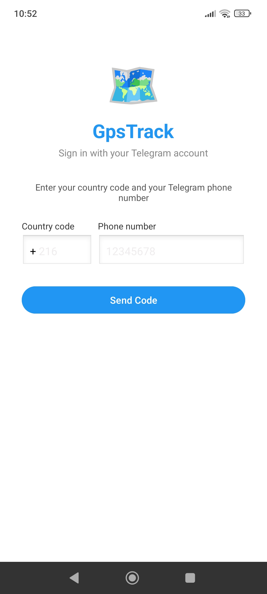
  &nbsp;&nbsp;
  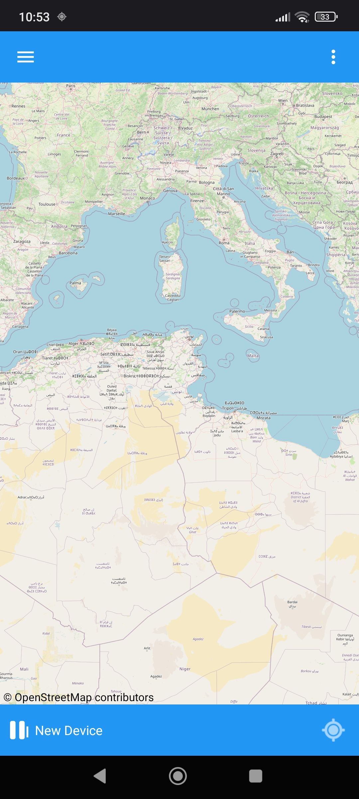
  &nbsp;&nbsp;
  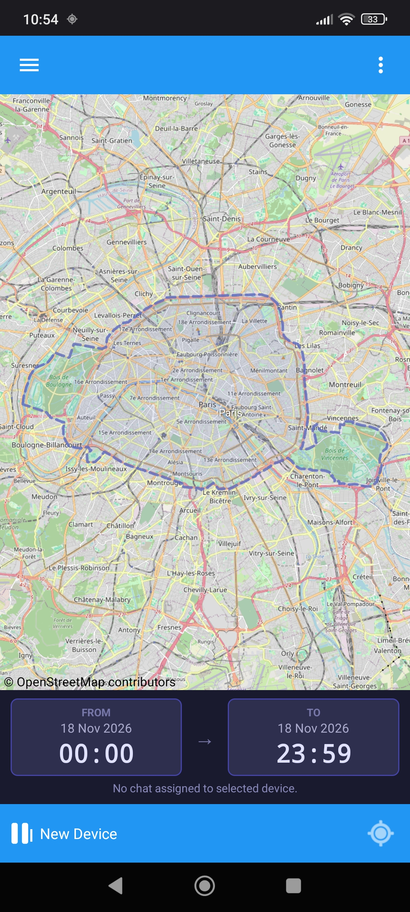
</p>

<p align="center">
  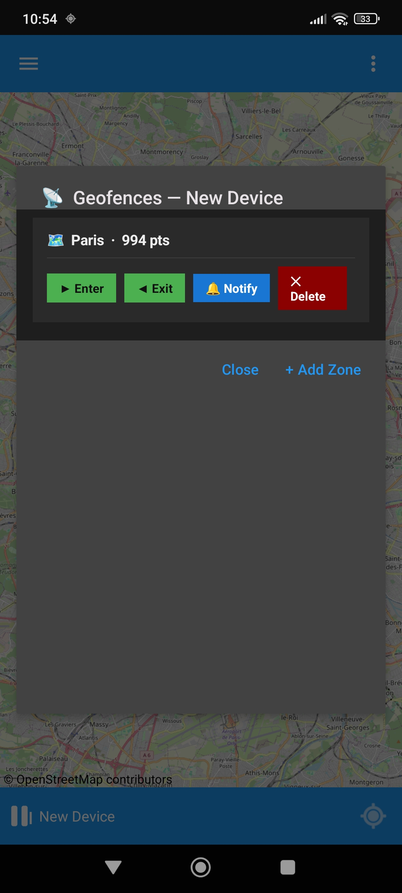
  &nbsp;&nbsp;
  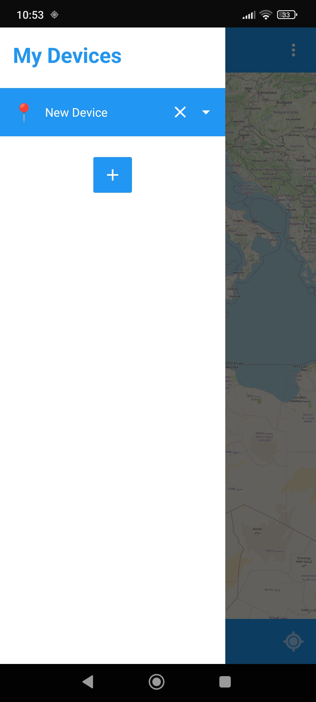
  &nbsp;&nbsp;
  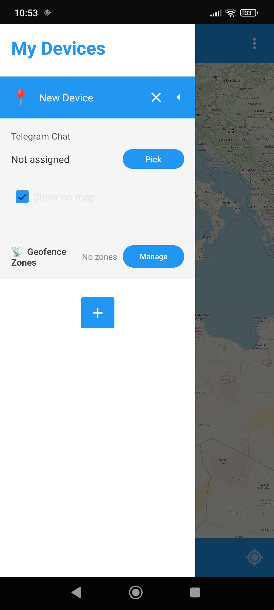
</p>

<p align="center">
  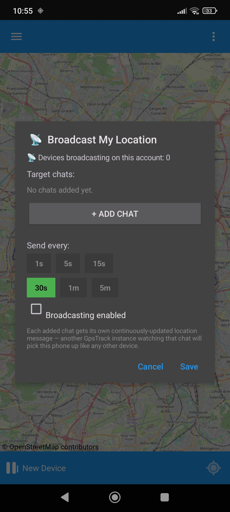
  &nbsp;&nbsp;
  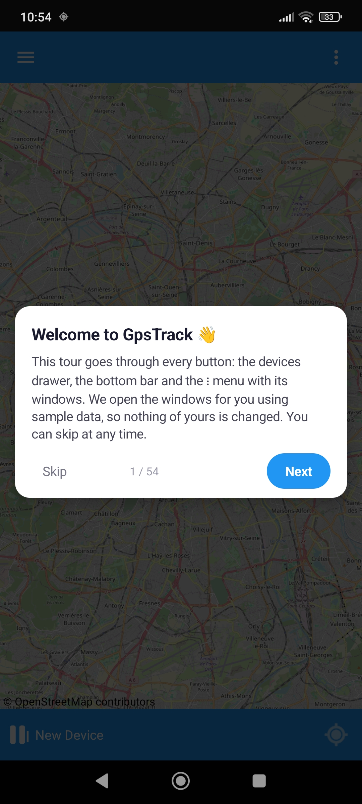
  &nbsp;&nbsp;
  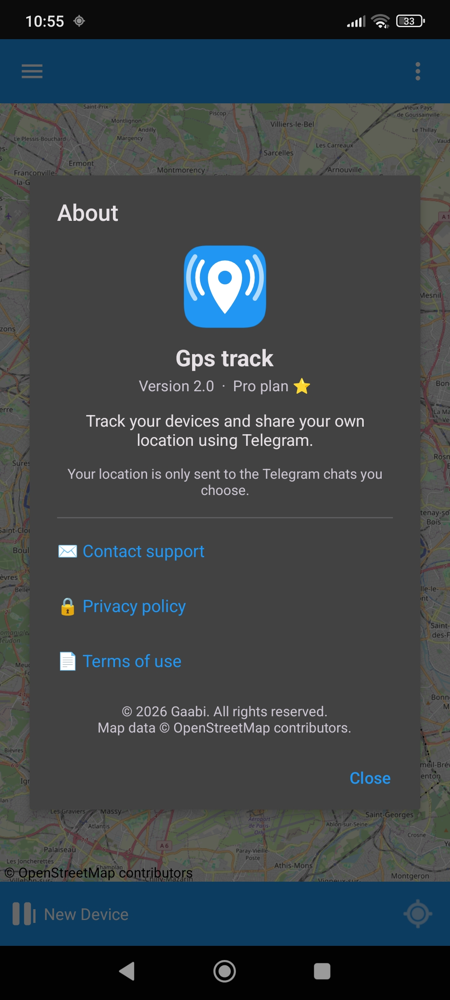
</p>

---

## 🔧 How It Works

```
GPS Tracker → sends JSON location → Telegram Bot → GpsTrack App → Map
```

1. Your GPS tracker sends a location message to a Telegram bot in this format:
```json
{"lat": 36.80, "lon": 10.18, "battery": 85, "speed": 72}
```
2. GpsTrack receives it instantly through your Telegram account
3. The map updates in real time

The app also supports native **Telegram Live Location** messages — no tracker configuration needed if you just want to share your phone's location.

It also works in reverse — GpsTrack can read your phone's own GPS and broadcast it out the same way, turning your phone into the tracker:

```
GpsTrack App → broadcasts phone's GPS → Telegram Chat(s) → another GpsTrack instance → Map
```

See **🛰️ Broadcast My Location** below.

---

## 📱 Requirements

- Android 7.0 or higher
- A Telegram account
- A GPS tracker that sends location to a Telegram bot (or any device sharing a live location)

---

## 🎁 Get the App — Free, No ADS

GpsTrack is free to download and has no ads. The Free plan tracks one device; upgrade to Pro for unlimited devices (see [Free vs Pro](#-free-vs-pro)).

### Step 1 — Register via the bot

Open Telegram and start a chat with **[@White_List_111_bot](https://t.me/White_List_111_bot)**, then send `/start`.

<p align="center">
  
</p>

### Step 2 — Receive your APK

The bot sends you the APK file directly in Telegram.

<p align="center">
  
</p>

### Step 3 — Install and enjoy

Install the APK, log in with the same Telegram account, and start tracking.

---

## 📲 Installation Guide

### Step 1 — Download the APK

Save the APK file sent by the bot to your Android device.

### Step 2 — Allow Unknown Sources

Since GpsTrack is distributed outside the Play Store, you need to allow installation from unknown sources:

1. Go to **Settings → Apps** (or Security on older devices)
2. Tap **Install unknown apps** or **Special app access**
3. Select your file manager or browser
4. Enable **Allow from this source**

> ℹ️ The exact steps may vary depending on your Android version and device manufacturer.

### Step 3 — Install

<p align="center">
  
</p>

1. Open the APK file from your file manager
2. Tap **Install**
3. Tap **Open** when done

---

## 🔑 First Launch

### Login with Telegram

<p align="center">
  
  &nbsp;&nbsp;
  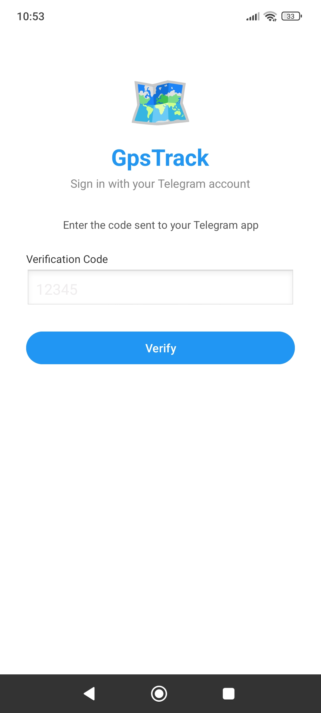
  &nbsp;&nbsp;
  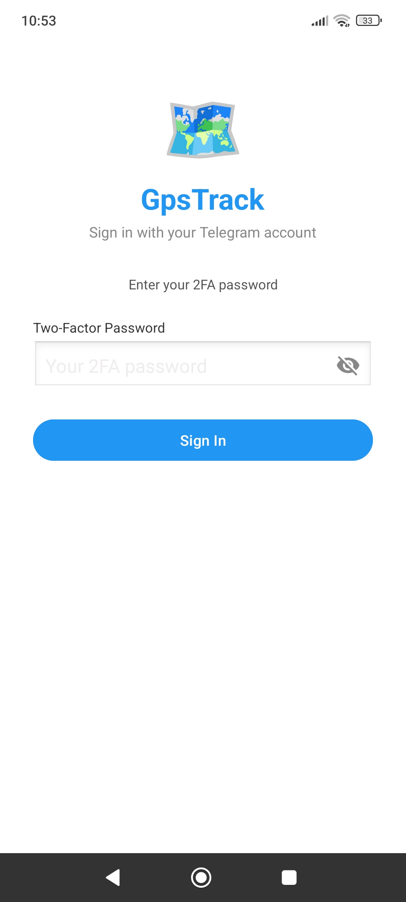
</p>

1. Enter your country code and phone number
2. Enter the verification code sent to your Telegram app
3. Enter your 2FA password if you have one enabled

> ℹ️ The app logs in using the **same Telegram account** you used to register with the bot. This is how your registration is verified.

On a fresh install, the app then offers a short guided tutorial (see [Guided Tutorial](#-guided-tutorial)).

---

## 🗺️ Using the App

### Adding a Device

<p align="center">
  
</p>

1. Tap the **☰ menu** icon (top left) to open the **My Devices** drawer
2. Tap **+** to add a new device
3. Tap the **▶ arrow** on the device row to expand its settings
4. Next to **Telegram Chat**, tap **Pick** to choose your tracker's Telegram chat

### Device Settings

<p align="center">
  
</p>

Each device row expands to show:

- **Marker icon** — tap the icon to choose one of 12 emoji markers
- **Telegram Chat** — the chat this device reports to (tap **Pick** to change it)
- **Show on map** — hide or show the device without deleting it
- **Last update** — when the device last reported
- **📡 Geofence Zones** — how many zones it has, and a **Manage** button

### Live Tracking

<p align="center">
  
</p>

Once assigned, the device marker appears on the map and updates in real time. A **green glow** means the device sent an update in the last 15 seconds.

### Map Lock

Tap the **crosshair button** (bottom right) to lock the map onto the selected device. The button turns **blue** when locked. The map follows the device automatically. To unlock, simply pan or zoom the map.

### Bottom Status Bar

<p align="center">
  
</p>

The bottom bar shows the selected device name, battery level, and speed. Tap the device name to switch between devices. Switch between km/h and mph from **⋮ → Speed**.

---

## 📜 Location History

<p align="center">
  
</p>

See where the selected device has been between any two moments.

1. Tap **⋮** (top right) → **Location History**
2. A bar appears at the bottom with **FROM** and **TO** clocks — by default, today from 00:00 to 23:59
3. Tap either clock to choose its date and time; the map updates as you change the range
4. The route is drawn as a trail: the **first point is green**, the **last point is red**, and the points in between are small **amber dots**
5. Tap any dot to see a bubble with its **date and time, speed, and battery level**
6. The bar shows how many points were found. Very long trails are thinned automatically so the map stays smooth
7. Tap **⋮ → Location History** again to close it

---

## 📡 Geofence Zones

<p align="center">
  
</p>

Geofences are virtual boundaries. The app notifies you when a device enters or exits a zone — for example *"📍 Car — Device entered "Home""*.

### Adding a Zone

1. Open the sidebar → expand a device → under **📡 Geofence Zones** tap **Manage**
2. Tap **+ Add Zone**
3. Choose a **Circle Zone** (centred on the device's current location, or the map centre if unknown) or **🗺 Search Place** to find a place by name
4. Tick **Alert on Enter** and/or **Alert on Exit**
5. Confirm with **Add Zone**

When you search for a place, GpsTrack loads its **real boundary** (a city, district, park…) from OpenStreetMap. If a place has no boundary available, a 500 m circle is created instead.

---

## 🛰️ Broadcast My Location

<p align="center">
  
</p>

Turn the process around: instead of watching another device, let GpsTrack read **your own phone's GPS** and send it out over Telegram — so this phone becomes the tracked device for another GpsTrack instance (or anyone watching that chat).

### Setting It Up

1. Tap **⋮** (top right) → **📡 Broadcast My Location**
2. Tap **+ Add chat** to choose one or more Telegram **bots or channels** to send your location to. You can also create a new bot or channel right from this window
3. Pick an update interval — **1s, 5s, 15s, 30s, 1m,** or **5m**
4. Check **Broadcasting enabled** and tap **Save**
5. Allow the location permission prompt the first time you enable it

The first time you switch broadcasting on, the app tells you exactly who will be able to see your location, and may offer to create a small private helper bot called **"GpsTrack Presence"** in your Telegram account. It is only used to count how many of your phones are broadcasting — it never carries your location, and only you can see it.

Once running, a persistent notification stays visible while broadcasting is active, showing which chat (or how many chats) are receiving updates. Each chat gets **one continuously-updated message** rather than being spammed with a new one every tick. If your phone's Location switch is off, the notification turns into a warning and tapping it opens the Location settings.

> ℹ️ Only bots and channels can be used as targets, because nobody else can post in them — so nobody can feed fake locations into your map. You can broadcast to as many targets as you like at once, and remove any of them at any time by tapping **✕** next to it in the list.

> ℹ️ The Free plan allows **one broadcasting phone per account**. Pro lets several phones broadcast at once.

> ⚠️ Very short intervals (1s–5s) combined with several target chats send a lot of updates in a short time and may occasionally get throttled by Telegram. If you notice missed updates on some chats, try a longer interval.

---

## 🎓 Guided Tutorial

<p align="center">
  
</p>

A short spotlight tour walks you through the drawer, device settings, marker icons, zones, history, broadcast and the menu. It starts automatically on a fresh install, and you can replay it any time from **⋮ → 🎓 Show tutorial**.

The tour uses **sample data only** (a "Demo device" and sample zones) — nothing of yours is changed.

---

## ℹ️ About & Support

<p align="center">
  
</p>

Open **⋮ → ℹ️ About** to see your app version and plan (Free or Pro ⭐), the **Privacy policy**, the **Terms of use**, and a **Contact support** button that opens the support bot.

---

## ❓ Troubleshooting

**Location updates stop after a few minutes**
Go to Settings → Apps → GpsTrack → Battery → select **Unrestricted**. This is especially important on Samsung, Xiaomi, Huawei, and OnePlus devices.

**My chat doesn't appear in the list**
Open a conversation with your tracker bot in the official Telegram app at least once before using GpsTrack.

**Access screen appears after login**
Make sure you registered with [@White_List_111_bot](https://t.me/White_List_111_bot) by sending `/start` first.

**Map shows no tiles**
Check your internet connection. The map requires an active connection to load.

**Broadcast My Location won't turn on**
Make sure you granted the location permission when prompted, and that you've added at least one target chat — broadcasting turns itself off automatically if either is missing. You can check the permission anytime in Settings → Apps → GpsTrack → Permissions.

**"Your Free plan allows one broadcasting device"**
Another phone on your account is already broadcasting. Turn broadcasting off there, or upgrade to Pro.

**Broadcasting says Location is off**
Turn on Location in your phone's quick settings (or tap the notification to open the Location settings). Broadcasting resumes as soon as Location is on.

**Broadcasting stops after a while**
Same cause as live tracking above — GpsTrack needs to run unrestricted in the background. Go to Settings → Apps → GpsTrack → Battery → select **Unrestricted**.

---

## 📞 Support

For help or questions:

<p align="center">
  <a href="https://t.me/White_List_111_bot">
    
  </a>
</p>

Support is available in **English**.

---

## 🔒 Privacy

Your location is only ever sent to the Telegram chats **you** choose. The Privacy policy and Terms of use are available in the app under **⋮ → About**.

---

## ⚠️ Disclaimer

GpsTrack is intended for lawful use only — tracking your own vehicles, devices, or dependents with their knowledge and consent. The developer is not responsible for any misuse of the application.

---

© 2026 Gaabi. All rights reserved. Map data © OpenStreetMap contributors.
This repository contains documentation and screenshots only — the GpsTrack source code is not published.
